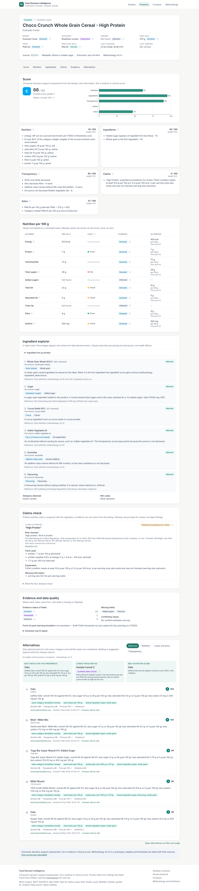

# Food Decision Intelligence

**Understand. Evaluate. Compare. Decide.**

AI-Based Multimodal Packaged Food Analysis and Consumer Decision Support System.
Minor project, MSIT (GGSIPU), New Delhi. Idea originated by **Sneha Juyal**.
Team: Sneha Juyal, Radhika, Shinjini. Guides: Dr. Sudesh Pahal, Dr. Neeru Rathee.

Paste a packaged-food product page, or upload a pack photo, an app screenshot or a page saved from the
browser. The system reads it (fetching a URL safely, or reading the file with nothing fetched), extracts the listing, normalises every
value to per 100 g/ml with its evidence label and source, stores it in PostgreSQL, scores nutrition,
ingredients, transparency, claims and value with explanations, checks front-of-pack claims against FSSAI
conditions, and suggests alternatives from stored products only, from the same shop (for example Blinkit)
when the product came from one.

> Status (17 Oct 2026): URL-first V1 with photo and saved-page upload. Consumer decision support, not a
> medical or clinical score. Photos are read by Claude's vision model (needs `ANTHROPIC_API_KEY`); values
> are kept only if they appear in the model's transcript of the label, and photo-reading accuracy has not
> been measured. Barcode scanning, cross-source validation, personalisation, basket optimisation and lab
> evidence are future work and are not implemented. No accuracy figures are claimed; see [docs/nutriscore_comparison.md](docs/nutriscore_comparison.md) and
> [reports/final_report.md](reports/final_report.md) for what was measured and on how much data.



## Quick start

```bash
cp .env.example .env
docker compose up --build        # web http://localhost:3000, API docs http://localhost:8000/docs
```

Without Docker: `./run.sh setup && ./run.sh migrate && ./run.sh seed`, then `./run.sh api` and
`./run.sh web`. Details, the offline URL demo and production notes: [docs/deployment.md](docs/deployment.md).

**About the sample data.** Seeding loads 466 **real Open Food Facts India records** (ODbL, no prices,
`data/sample/off_india_subset.jsonl`) plus 40 **synthetic** demo products with made-up prices so
value-for-money can be shown; the synthetic ones are labelled in the database, API and UI. The full India
extract (2,692 records) is reproducible with `./run.sh off-export`. See [data/sample/README.md](data/sample/README.md).

## What it does

| Page | |
| --- | --- |
| Landing (`/`) | URL input, photo / screenshot / saved-page upload with the shop it came from, how it works, an illustrative sample (labelled synthetic), evidence standards, limitations |
| Product report (`/products/{id}`) | Score and grade, dimension explanations, nutrition per 100 g/ml with traffic lights, printed vs normalised values, ingredient explorer, claim panel, missing and conflicting fields, extraction log, alternatives |
| Compare (`/compare`) | 2–6 stored products in one category on one basis, picks with reasons, ingredient differences |
| Alternatives | Balanced, nutrition, lower unit price or transparency; stored records only, from the same shop when known (falls back to all stored products and says so); says so when none qualify |
| Methodology (`/methodology`) | Weights, thresholds and claim rules with sources, missing-data rules, limitations, data licences |

API: `POST /api/analyze-url`, `POST /api/analyze-upload`, `GET /api/products`, `GET /api/products/{id}`, `POST /api/products/compare`,
`GET /api/products/{id}/alternatives`, `GET /api/reference/categories`, `GET /api/reference/methodology`,
`GET /api/health`. See [docs/api.md](docs/api.md).

## Never invent data

Every field carries one of five evidence labels: **declared**, **derived**, **interpreted**, **verified**,
**unknown**. Missing values stay missing (the database rejects a zero for an unknown nutrient).
Conflicting sources are flagged, not resolved silently. Thresholds and FSSAI conditions live in
`data/reference/*.csv` with their sources; values not yet published are `TODO` and make the system say
"cannot be verified" instead of guessing. The optional LLM fallback (`ANTHROPIC_API_KEY`) can only locate
values that appear verbatim on the page, and is never the authority on a claim.

## Layout

```
config/scoring.json        weights, grade bands, curves (methodology v0.1.0)
data/reference/            thresholds, FSSAI claim rules, INS codes, ingredient terms and classes, OFF category map
data/sample/               synthetic demo records (labelled)          data/verified/  evaluation labels
migrations/                Alembic migrations                         scripts/        OFF download, sample generator
src/extract/               SSRF-safe fetch, JSON-LD, HTML, LLM fallback
src/normalise/             units, ingredients, product builder        src/analyse/    the five dimensions
src/score/                 scoring and grades                         src/recommend/  similarity, alternatives, compare
src/database/              models, repository, ingestion              src/api/        FastAPI app
src/evaluation/            metrics and evaluation runner              src/services.py URL -> stored, scored record
web/                       Next.js + TypeScript + Tailwind + Recharts
notebooks/evaluation.ipynb evaluation with real sample sizes          tests/          pytest (Python), web/src/__tests__ (Vitest)
docs/                      architecture, methodology, data sources, regulatory rules, API, deployment, screenshots
```

## Open items for the team

1. **Protein RDA reference:** claims use 54 g/day (ICMR-NIN 2020, sedentary adult man). Confirm with the guides.
2. **Verified set:** fill the pack-checking sheet (`data/verified/pack_check/`, 150 real products plus
   reserves) from real packs, then run `python -m evaluation.pack_check`. OFF is crowdsourced and 85 % of its
   India records in these categories cannot be graded.
3. **Front-of-pack warning thresholds** (`fop_warning.csv`) stay TODO until FSSAI publishes them; the red
   bounds in `thresholds.csv` are UK FSA 2016 placeholders.
4. Verify `ins_codes.csv` and `allergens.csv` (status `seed_verify`), and the FSSAI regulation's
   commencement date (blank in `fssai_claims.csv`).
5. Code licence not chosen yet (MIT or AGPL-3.0, doc section 13.7).

## Data and licence

Open Food Facts data is under the Open Database License (ODbL); credit it and share-alike any derived
database. A public product page is not permission to scrape: the fetcher respects robots.txt and rate
limits, and the cache is git-ignored. See [docs/data_sources.md](docs/data_sources.md).
