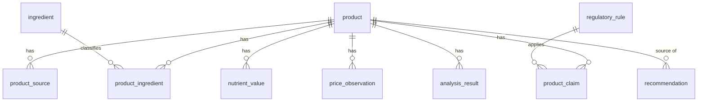

# Database and API

Checked against `src/database/models.py`, `migrations/versions/`, `src/api/main.py` and the live
`/openapi.json` of the local API on 16 November 2026. The full request/response reference is
[api.md](api.md); this document summarises it and the data model.

## 1. Database

PostgreSQL (EDB PostgreSQL 18 on the team Mac, PostgreSQL 16 in Docker Compose, Neon when hosted), accessed
through SQLAlchemy 2 and versioned with Alembic. Tests use SQLite unless `TEST_DATABASE_URL` is set.
`alembic current` on the local database reported **`0002 (head)`**.

| Migration | Contents |
| --- | --- |
| `0001_normalised_schema.py` | All ten tables with CHECK constraints |
| `0002_site_and_upload_sources.py` | `product_source.site` (+ index, backfilled from URL host); source types `photo` and `saved_page` added |

| Table | Key columns | Constraints worth knowing |
| --- | --- | --- |
| `product` | `external_product_id` (`url:<sha>`, `off:<code>`, `sample:<id>`, `photo:<hash>`…), barcode, name, brand, category, variant, pack size/unit, nutrition basis, ingredients text, `field_evidence` (JSON: value, label, source, note per field incl. price, MRP, discount, availability, multipack, retailer, image URL), additives, allergens, claims, conflicts, warnings | category in the five ids; pack unit g/ml; pack size > 0; basis per_100g/per_100ml |
| `product_source` | source type, URL, `site`, collected/verified time, reliability, extraction method, extraction log | type ∈ url, open_food_facts, synthetic_sample, manual, photo, saved_page |
| `nutrient_value` | (product, nutrient) PK, original value and unit as printed, normalised value and unit, basis, evidence status, source, note | `unknown` ⇒ value NULL; value ≥ 0 |
| `ingredient` | canonical name, functional category, description, reference source | unique name |
| `product_ingredient` | (product, sequence) PK, original label text, declared percent, match status, evidence, detail JSON | sequence ≥ 1; match ∈ matched/fuzzy_match/uncertain |
| `regulatory_rule` | rule key, jurisdiction, criteria JSON, regulation, clause, source URL, effective and checked dates, status | 18 rows loaded by `./run.sh migrate` |
| `product_claim` | original claim, claim type, applicable rule, status, explanation, facts, missing information | status ∈ the four claim statuses |
| `price_observation` | price ₹, pack size/unit, price per 100 g/ml, source URL, source, evidence, `observed_at` | price > 0 |
| `analysis_result` | methodology version, five dimension scores, overall, grade, status, price per 100, full report JSON | overall 0–100; grade A–E; status complete/partial/insufficient_data |
| `recommendation` | source and alternative product, preference, ranking, rationale, matching attributes, version | not self; ranking ≥ 1 |

Local database contents at the time of checking (read-only SQL): 507 products and sources (466
`open_food_facts`, 40 `synthetic_sample`, 1 `url`), 35 price observations (synthetic), 18 regulatory
rules. The running API's `/api/health` reported `product_count` 508 at the same time; the one-record
difference was not investigated further (it may be a second database or a record added between the
checks).

Candidate data in `data/annotation/` is **not** in the database. No migration was added for the
acquisition models; they are JSON/JSONL files.

## 2. API routes

Eleven application routes, confirmed in `/openapi.json`:

| Method and path | Purpose | Saves? | Rate limited |
| --- | --- | --- | --- |
| `GET /api/health` | Status, database reachability, methodology version, product count | — | no |
| `POST /api/product-candidates/from-url` | Candidate preview from an authorized URL | **no** | yes |
| `POST /api/analyze-url` | Fetch, extract, normalise, store and score | yes | yes |
| `POST /api/analyze-upload` | Photo/screenshot (OCR or vision) or saved `.html` (local parse), with optional corrections | yes | yes |
| `POST /api/analyze-manual` | User-entered details, unverified | yes | no |
| `GET /api/products?category=&q=&limit=` | List stored products (limit 1–500, default 50) | — | no |
| `GET /api/products/{id}` | Full explainable report | — | no |
| `POST /api/products/compare` | Compare 2–6 stored products in one category | — | no |
| `GET /api/products/{id}/alternatives?preference=&limit=&scope=` | Alternatives from stored records | stores recommendations | no |
| `GET /api/reference/categories` | Categories with product counts | — | no |
| `GET /api/reference/methodology` | Weights, thresholds, claim rules, evidence labels, limitations, data sources | — | no |

Interactive docs: <http://localhost:8000/docs>.

Errors use `{"detail": {"code", "message"}}` except the candidate route, which returns its own
`ProductURLResult` with `status`, `error_code`, `message` and `issues`. Error codes and statuses are
listed in [api.md](api.md#api-reference) and
[PRODUCT_DATA_ACQUISITION.md](PRODUCT_DATA_ACQUISITION.md#4-error-handling-task-2a-63).

Limits: JSON bodies ≤ 64 KB (`MAX_REQUEST_BYTES`); uploads ≤ 9 MB with Content-Length required
(`MAX_UPLOAD_BYTES`; images ≤ 8 MB, HTML ≤ 5 MB); `RATE_LIMIT_PER_MINUTE` (default 10) per client on the
three fetch/upload routes; fetch timeout 15 s and 3 MB.

## 3. Consistency findings

* `docs/api.md` lists the same eleven routes as the code. Its "Limits" section said only `analyze-url` and
  `analyze-upload` are rate limited; the candidate route is too, and api.md has been corrected.
* `docs/api.md` said unknown sources are blocked by `analyze-url`. The code (changed 16 Nov 2026) fetches
  unregistered hosts once as user-submitted pages, and the team confirmed this is intended; api.md now
  describes it. See [SYSTEM_ARCHITECTURE.md](SYSTEM_ARCHITECTURE.md#2-four-ways-in).
* The methodology endpoint's data-source list names `scripts/ingest_off.py`; the actual loader is
  `src/database/ingest.py`. This is a text string in `src/api/main.py`; code was left unchanged and the
  finding is recorded in the consolidation report.
