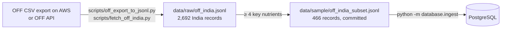

# Datasets and data engineering

All counts below were recounted from the files on 16 November 2026 (`wc -l`, manifests and CSV readers).
Licences and outside sources are in [RESEARCH_RESOURCES_AND_DATA_SOURCES.md](RESEARCH_RESOURCES_AND_DATA_SOURCES.md)
and [data_sources.md](data_sources.md).

## 1. Dataset inventory

| Dataset | Path | Records (checked) | Status | Used for |
| --- | --- | --- | --- | --- |
| Open Food Facts India subset | `data/sample/off_india_subset.jsonl` | **466** | Real, crowdsourced, ODbL; reference data, not ground truth; no prices | Seeded into PostgreSQL; scoring, alternatives, Nutri-Score agreement |
| Full OFF India extract | `data/raw/off_india.jsonl` (git-ignored, reproducible) | 2,692 (per `reports/nutriscore_comparison.json`) | Real, regenerated by `./run.sh off-export` | Nutri-Score funnel |
| Synthetic demo products | `data/sample/synthetic_products.jsonl` | **40** (8 per category) | Synthetic; names "Sample …", brands "Demo Brand …", codes `SYN-`, `_synthetic: true` | Demonstrating value for money and price alternatives. **Their prices are made up and are not retailer prices** |
| Reference tables | `data/reference/*.csv` | thresholds 13, category weights 20, FSSAI claims 18, INS codes 64, ingredient terms 219, ingredient classes 36, allergens 9, category keywords 5, OFF category map 10, front-of-pack warning 6 (TODO) | Sourced or team-defined; status per row | Analysis and scoring |
| Evaluation labels | `data/verified/eval/` | extraction gold 4 pages × 15 fields; ingredient gold 57 phrases; claim gold 22 cases | Small, team-labelled, not independent | `evaluation.run` |
| Pack-check sheet | `data/verified/pack_check/pack_check_sheet.{csv,xlsx}` | 200 rows (150 main + 50 reserve); **0** checker fields filled | Template | Future verified set |
| Price-entry sheet | `data/verified/prices/price_entry_sheet.{csv,xlsx}` | 300 rows (Zepto + Blinkit per pack-check product); **0** prices filled | Template | Future hand-recorded prices |
| Verified products template | `data/verified/verified_products_template.csv` | header only | Template | Future |
| Consolidated annotation candidates | `data/annotation/imported_candidates/` | **85** candidates from 3 workbooks | Unverified, `pending_review` | Annotation review queue |
| Complete Product Catalog candidate release | `data/annotation/candidate_sources/complete_product_catalog/` | **25** product/listing records, **75** unverified price observations, 125 image references, 45 source rows | Unverified, isolated | Annotation and price research |

The brief's earlier figures (466, 40, 85, 25 and 75) all match the current files. The README and
`data_sources.md` said "66 INS codes"; the file has **64** rows, and those two documents have been
corrected.

## 2. Open Food Facts pipeline

* Five categories are mapped from OFF category tags by `data/reference/off_category_map.csv`
  (`database/ingest.category_for`). Committed subset by category: beverages 197, biscuits and cookies 99,
  namkeen and chips 80, breakfast cereals 55, instant noodles 35.
* Missingness in the 466 (from `real_data_coverage`): price 100 %, trans fat 73 %, fibre 55 %, pack size
  38 %, ingredients 25 %; energy, fat, protein and carbohydrate about 11–12 %. Report status: 405 partial,
  61 insufficient data, 0 complete.
* OFF values are stored with source `open_food_facts`, reliability `open_food_facts_crowdsourced`.

## 3. Candidate dataset pipelines (research data, unverified)

### 3.1 Workbook consolidation

`scripts/consolidate_product_datasets.py` reads three research workbooks read-only (paths and SHA-256
hashes in `imported_candidates/import_manifest.json`):

| Workbook | Candidates added |
| --- | --- |
| `misleading_indian_food_products.xlsx` | 22 |
| `indian_packaged_food_annotation_records.xlsx` | 25 |
| `master_verified_food_corpus.xlsx` | 38 (38 supplemental rows linked) |
| **Total** | **85** |

The workbooks themselves are on Sneha's Mac in `~/Downloads`, not in the repository. Outputs: JSONL,
CSV and XLSX of candidates, `duplicate_candidates.csv` (37 possible duplicate groups, 45 pairs),
`category_mapping_review.csv` (75 mapped-requires-review, 10 unassigned), `claim_verification_queue.csv`
(85), `malformed_suspicious_records.csv` (1). **No automatic merges.** Every candidate has
`annotation_status: pending_review` and `pipeline_verification_status: unverified`. The validator
(`scripts/validate_annotation_dataset.py`) reports 0 errors and 0 warnings. A workbook's name ("master
verified") does not establish verification.

### 3.2 Complete Product Catalog import

`scripts/import_product_catalog_candidate.py` → `acquisition/catalog_workbook.py` (importer
`complete-product-catalog/1.2`), read-only on `Complete_Product_Catalog_With_JSON_Photos.xlsx`
(SHA-256 `66b23c65…`). Registered as source `complete_product_catalog` (operator file, network access off).
Outputs 25 candidate annotations, 100 acquisition records (25 listings + 75 price observations for Blinkit,
Zepto and Swiggy Instamart), 125 image references (front, back, ingredient label, nutrition table, barcode
photo links), the 45 raw workbook rows and quality reports. Image links are references only; they are not
fetched. The workbook's own column header says its price range is "indicative planning range only, not a
verified live quote", so all 75 prices are unverified candidate observations.

## 4. Annotation infrastructure

* `data/annotation/schema_v1.json`: annotation schema with identity (family, variant, pack, GTIN), label
  (ingredients original, nutrition with original values, serving, claims, allergens), field states
  (`missing`, `requires_review`, …), provenance and review fields.
* `docs/annotation_guidelines.md`, `docs/annotation_data_dictionary.md`, templates for records and review
  log.
* `scripts/create_grouped_splits.py`: deterministic family-grouped or brand-held-out split manifests.
  No split has been produced yet (`data/annotation/splits/` holds only `.gitkeep`).

## 5. Product identity methodology

Following `reports/PRODUCT_IDENTITY_MATCHING_PLAN.md`, the annotation schema and the acquisition models
(`acquisition/models.py`):

| Level | Represented by | Rule |
| --- | --- | --- |
| Product family | annotation schema `identity.family.name` | Brand + line, e.g. one biscuit range |
| Exact variant | annotation `identity.variant.{name, flavour, formulation}`; acquisition `ProductIdentity.variant` | Different flavours are different products |
| Pack | `ProductIdentity.gtin` (optional), `pack_quantity`, `pack_unit`, `multipack_count` | Different pack sizes are different records |
| Retailer listing | `RetailerListing` (retailer, listing id, URL, name, image references) | One listing per retailer page |
| Price observation | `PriceObservation` (selling price, MRP, discount, availability, currency, `observed_at`, PIN-code location) | Dated; never overwrites another |

Different variants or pack sizes are never merged automatically; possible duplicates go to a review queue.
Barcode capture is optional and deferred.

## 6. Provenance and quality validation

* Each acquired field is a `FieldValue` with a state and `FieldProvenance` (source id, source URL or
  workbook sheet/row, extraction method, time, adapter version).
* `acquisition/validation.py` reports issues with these codes: `invalid_gtin` (check digit),
  `invalid_source_url`, `invalid_price`, `invalid_discount`, `invalid_quantity`, `invalid_quantity_unit`,
  `invalid_multipack_count`, `missing_currency`, `unsupported_currency`, `missing_observation_time`,
  `missing_provenance`, `missing_value` and `duplicate_observation_candidate`. Times must be
  timezone-aware and PIN codes six digits (model validators).
* Raw records carry a SHA-256 payload hash.
* In the runtime database, every value carries an evidence label and source; `nutrient_value` keeps
  `original_value` and `original_unit` beside the normalised value.

## 7. Rules that keep data honest

1. Candidate data is never promoted into verified evaluation or training data.
2. Synthetic prices are never presented as retailer prices; synthetic records carry a badge in the UI and
   `is_synthetic: true` in the API.
3. Missing values are unknown, not zero.
4. Image references are not verified images.
5. Retailer prices are recorded by hand only (no scraping); none have been recorded yet.
