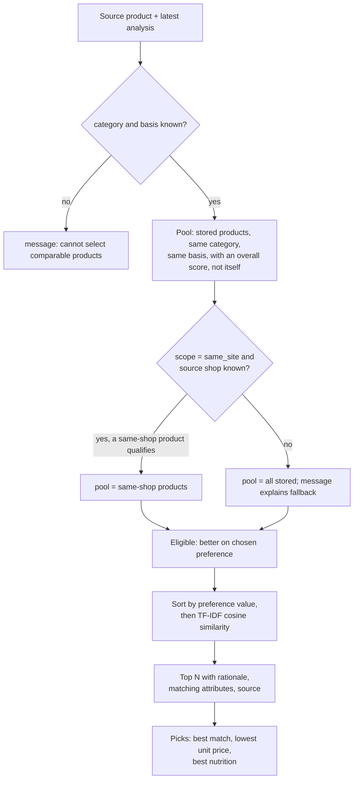

# Product comparison, alternatives and price intelligence

From `src/recommend/alternatives.py`, `src/recommend/similarity.py`, `src/analyse/value.py` and
`src/database/prices.py`, checked 16 November 2026. **No trained recommender model exists**: everything
here is rule-based selection plus TF-IDF similarity over stored records.

## 1. Comparison (`POST /api/products/compare`, `compare_stored`)

| Step | Rule |
| --- | --- |
| Selection | 2–6 stored product ids chosen by the user on the Compare page |
| Category matching | All must share one category, else 422 "Compare products from one category" |
| Basis matching | All must share per 100 g or per 100 ml, else 422 |
| Missing analysis | A stored product without an analysis is analysed first |
| Priorities | Optional weights over nutrition, ingredients, transparency, claims, value; normalised to sum 1; default = methodology weights. `priority_score` = weighted mean over known dimensions |
| Nutrition comparison | Each nutrient per 100 g/ml with its evidence label and unit |
| Ingredient comparison | `ingredient_differences.shared_classes` and `only_in` per product |
| Unit price | `price_per_100` (₹ per 100 g/ml) |
| Completeness | Share of the 10 core fields known |
| Picks | `best_match` (highest priority score), `lowest_price_per_100`, `best_nutrition`, each with a written reason |
| Explanations | `rationale` lines say when data is partial or insufficient ("missing values are shown as unknown, not zero") or when no price is known |

## 2. Alternatives (`GET /api/products/{id}/alternatives`)

| Stage | Detail |
| --- | --- |
| Candidate retrieval | `repository.latest_analyses(category)`; stored records only, never generated, never crawled |
| Category filtering | Same category and nutrition basis; must have an overall score |
| Preference | `balanced` (overall score), `nutrition` (N), `transparency` (T), `price` (lower unit price **and** overall not lower) |
| Eligibility | Strictly better on the preference than the source product |
| Similarity | TF-IDF (unigrams + bigrams) over name, brand, category, ingredients; cosine kNN; used as tie-break and shown |
| Ranking | Preference value (descending; ascending for price), then similarity |
| Explanation | `rationale` (e.g. "overall 74 (B) against 58 (C); less sugar (12 g vs 28 g per 100 g)"), `matching_attributes` (same category, same basis, similar pack size within 0.5–2×, shared ingredient types) |
| Empty result | Explicit `message`, e.g. "No stored product in this category does better on nutrition than this one." |
| Storage | Results stored in the `recommendation` table |
| Scope | `same_site` default: products analysed from the same shop (e.g. blinkit.com) when one qualifies; else all stored, and the message says so |

Evaluation status: relevance metrics (Precision@3, NDCG@5) are implemented in `evaluation/metrics.py` but
**not run**, because no relevance judgements have been collected.

## 3. In-memory comparison (CLI)

`recommend/ranker.compare` does the same for unsaved pages from the command line
(`./run.sh compare a.html b.html --category X`), with reasons from `recommend/explain.py`.

## 4. Product identity in comparison

Different variants and pack sizes are separate records and are never merged; the OFF matcher only adds
a reference note. See [DATASET_AND_DATA_ENGINEERING.md](DATASET_AND_DATA_ENGINEERING.md#5-product-identity-methodology).

## 5. Price intelligence

| Item | Implementation |
| --- | --- |
| Retailer listing | Runtime: `product_source.site` (shop host, e.g. `blinkit.com`) from the URL or the upload form. Candidate data: `RetailerListing` records |
| Price observation | `price_observation` table: price, pack size and unit, price per 100 g/ml, source URL, source, evidence label, `observed_at` |
| Price per 100 g / 100 ml | `price ÷ pack size × 100` (`normalise/units.price_per_100`), basis from pack unit g or ml |
| Pack-size normalisation | `parse_pack_size` converts kg→g and l→ml, handles multipacks such as "6 × 50 g" |
| Observation dates | Every observation keeps `observed_at`; reports show "observed …" |
| Provenance | Source URL / platform per observation; hand-recorded imports keep platform, place (city/PIN) and evidence reference |
| Verification status | Evidence label per observation; candidate workbook prices are explicitly unverified |
| Import | `./run.sh prices data/verified/prices/price_entry_sheet.csv` skips rows without price, date, usable pack size or a confirmed product match, counts the reasons, never fills gaps, and rescores |

**Current price data (16 Nov 2026):**

* 35 price observations are in the local database, all from the **synthetic** demo records (made-up
  prices to demonstrate V and price-based alternatives; labelled synthetic).
* Open Food Facts has no prices.
* The price-entry sheet (300 rows) has **0 prices recorded**.
* The Complete Product Catalog candidate release has 75 **unverified** "indicative" price observations,
  not loaded into the database.

**No price shown by the application is a live retailer price.** Value-for-money scores on real products
therefore stay unknown until prices are recorded by hand.
