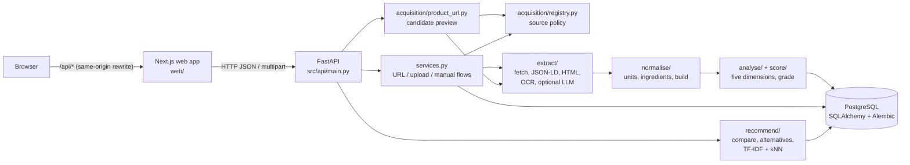
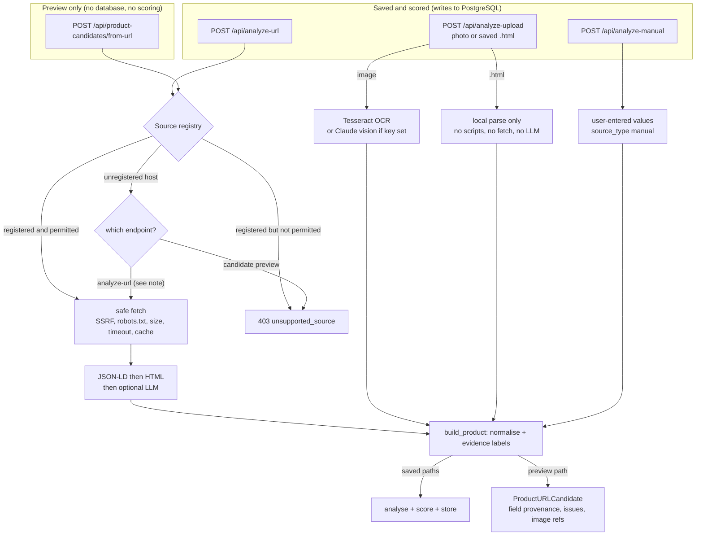
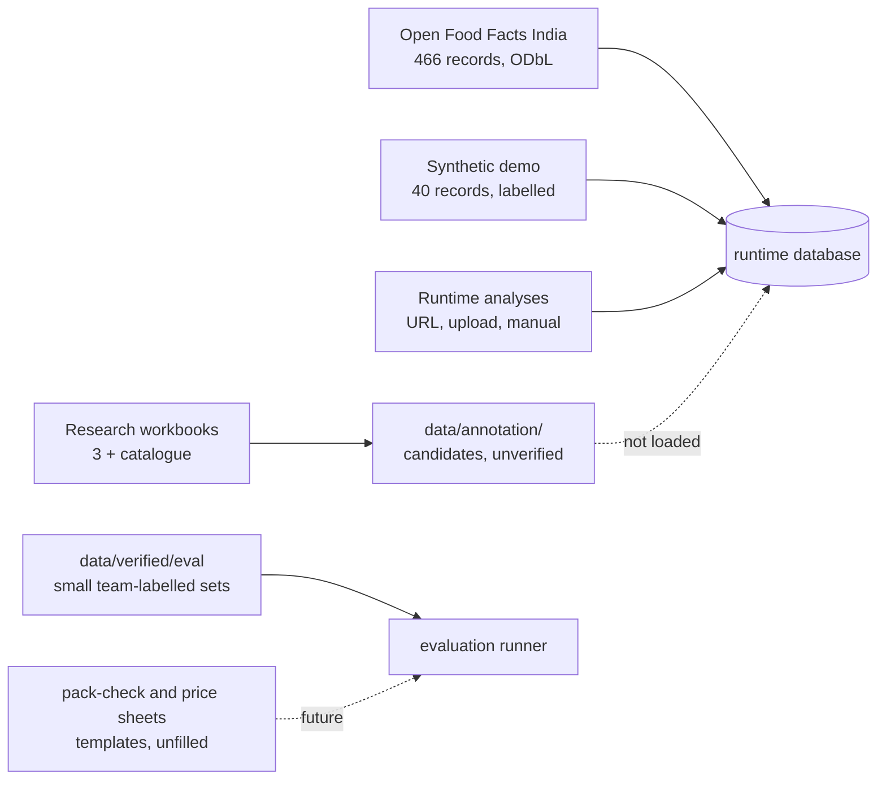

# System architecture

Consolidated 16 November 2026 from the code. The earlier, shorter description is in
[architecture.md](architecture.md); this document supersedes it where they differ (it adds the
acquisition layer, candidate preview, upload and manual-entry paths).

## 1. Components

| Layer | Folder | Responsibility |
| --- | --- | --- |
| Web client | `web/` (Next.js 16, React 19, TypeScript, Tailwind 4, Recharts 3) | Landing page with URL, upload and manual forms; product report; products; compare; alternatives; methodology |
| API | `src/api/main.py` (FastAPI) | Routes, request models, error shape, body-size limit, per-client rate limit, logging |
| Services | `src/services.py` | Orchestrates the saved URL, upload and manual-entry analyses |
| Acquisition | `src/acquisition/` | Source registry and policy decisions, acquisition models with field provenance, validation, dry-run orchestration, product URL candidate service, workbook candidate importer |
| Extraction | `src/extract/` | SSRF-safe fetch with robots.txt and cache, JSON-LD/microdata, HTML nutrition table, Tesseract OCR, optional Claude vision and text fallback, image URL checks |
| Normalisation | `src/normalise/` | Units (kJ→kcal, salt↔sodium, per serving→per 100), ingredient parsing and dictionary matching, product builder with conflicts, OFF matcher |
| Analysis and scoring | `src/analyse/`, `src/score/` | Nutrition, ingredients, transparency, claims, value; front-of-pack warning simulation; weighted score and grade |
| Recommendation | `src/recommend/` | Stored-product comparison and alternatives with explanations |
| Persistence | `src/database/` + `migrations/` | ORM models, repository, OFF/synthetic ingestion, hand-recorded price import |
| Evaluation | `src/evaluation/`, `notebooks/` | Metric code, evaluation runner, Nutri-Score agreement, OCR harness, pack-check scoring |
| Reference data | `data/reference/*.csv`, `config/scoring.json` | Thresholds, claim rules, INS codes, ingredient terms and classes, category weights, scoring weights |

## 2. Four ways in

**Unregistered hosts (intended behaviour, confirmed 16 Nov 2026).** The candidate preview blocks every
host that is not registered and permitted. The saved `analyze-url` blocks hosts that are registered but
disabled or not permitted, and fetches an *unregistered* host once, on the user's request, as a single
user-submitted page (SSRF checks, robots.txt, timeout, size limit and per-host spacing still apply; no
crawling). This replaces the stricter rule described in the Task 2A-6.2 report and is covered by
`tests/test_api_db.py::test_analyze_url_fetches_unregistered_public_page_as_user_submitted`.

## 3. Saved analysis pipeline

1. **Policy.** `acquisition.product_url.authorize_product_url` parses the URL by syntax only (no DNS) and
   asks the registry for a decision.
2. **Fetch** (`extract/fetch.py`). http(s) only, no credentials, ports 80/443, every resolved address must
   be public, redirects followed by hand (max 5) and re-validated, registered sources confined to their
   `allowed_domains`, `FETCH_TIMEOUT_SECONDS` (15), `FETCH_MAX_BYTES` (3 MB), HTML only, robots.txt
   honoured, `FETCH_MIN_HOST_INTERVAL_SECONDS` (1) per host, page cached in `data/cache/` (git-ignored).
3. **Extract** (`services.run_extraction`). JSON-LD/microdata, then the HTML nutrition table and labels,
   then the Claude fallback only if neither found nutrition or ingredients and `ANTHROPIC_API_KEY` is set.
   No usable name, ingredients, nutrition or pack size → `product_extraction_failed` (422).
4. **Normalise** (`normalise/build.py`). Per 100 g/ml, unit conversion, per-serving values scaled and
   labelled *derived*, printed values kept in `nutrition_original`, differences over 2 % flagged as
   conflicts.
5. **Match** (`services.match_open_food_facts`). Best stored OFF record by brand + name similarity
   (RapidFuzz token-set ratio, cutoff 85); logged as reference only, never merged.
6. **Store** (`database/repository.save_product`). One `nutrient_value` row per nutrient (NULL + unknown
   when missing), ingredients in label order, price observation, source with extraction method and log.
7. **Analyse and score** (`services.analyse_row` → `pipeline.analyse_product`). Five dimensions, overall
   score, grade, status; stored in `analysis_result` with `methodology_version`.

## 4. Candidate preview pipeline

`ProductURLExtractionService.acquire` runs steps 1–4 above and returns a `ProductURLResult` with a
`ProductURLCandidate`: the normalised product, an `AcquisitionRecord` (identity, listing, price
observations), per-field `URLFieldEvidence` (original value, normalised value, provenance, validation
status), image candidates (`url_syntax_valid_not_fetched`, association `product_entity` or
`page_level_unverified`), additional product entities found on the page, and validation issues. Nothing is
written to the database and nothing is scored or recommended.

## 5. Data separation

Candidate data in `data/annotation/` is never loaded into the scoring database and never treated as
verified training data.

## 6. Deployment

Local: PostgreSQL + `./run.sh api` + `./run.sh web` ([INSTALLATION_AND_EXECUTION.md](INSTALLATION_AND_EXECUTION.md)).
Docker Compose: `db`, `migrate`, `api`, `web`. Hosted: Vercel (web project and a separate API project,
`api/index.py` with the reduced `api/requirements.txt`), Neon PostgreSQL; `render.yaml` describes an
alternative Render API with Tesseract. See [deployment.md](deployment.md). The hosted deployment was not
re-verified during this consolidation.

Security notes: secrets come only from environment variables (`.env` is git-ignored); CORS is limited to
`CORS_ORIGINS`; bodies over 64 KB are refused except uploads (9 MB, Content-Length required); the DNS check
happens before connection, so DNS rebinding is not fully excluded and a public deployment should add an
egress firewall.
